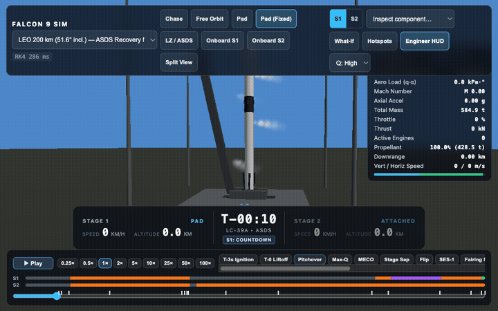

# Falcon 9 Block 5 Launch & Booster Landing Simulator

An interactive 3D browser simulation of a **Falcon 9 Block 5** orbital launch and autonomous first-stage booster recovery (liftoff → Max-Q → MECO → stage separation → Stage 2 ascent to orbit, in parallel with booster flip → boostback → entry burn → titanium grid-fin aerodynamic descent → hoverslam landing burn → touchdown on ASDS droneship or RTLS landing zone).

Built with **physics fidelity over spectacle**: a pure TypeScript, deterministic RK4 (`dt = 0.01 s`) simulation core decoupled from rendering, validated against real SpaceX webcast telemetry, stress-tested with a seeded Monte Carlo dispersion campaign, and paired with a React Three Fiber 3D viewer, click-to-inspect hardware panels, and a What-If scenario lab.



---

## Features

- **Pure TypeScript 3-DOF RK4 Physics Core** (`src/sim/`, zero Three.js/DOM imports):
  - Earth-centered inertial (ECI) integration with rotating WGS-84 Earth (`ω = 7.2921e-5 rad/s`), inverse-square gravity + optional J2 oblateness, and US Standard Atmosphere 1976 up to 86 km + exponential tail.
  - Pressure-dependent thrust (`T = T_vac − p_amb · A_exit`) and variable mass flow (`ṁ = T / (Isp · g₀)`) across 9× Merlin 1D (Stage 1) and 1× MVac (Stage 2).
  - Closed-loop Stage 2 linear-tangent orbital insertion with yaw plane steering (`< 0.05°` inclination error) and ZEM/ZEV optimal powered descent + terminal upright alignment gate for Stage 1 recovery.
- **Interactive 3D Viewer** (React Three Fiber + Three.js + Web Worker):
  - Floating-origin precision from pad liftoff to 200+ km LEO, soft volumetric GLSL exhaust plumes, post-entry-burn RP-1 soot, 18 m Block 5 landing legs, detailed Crew Dragon & satellite payload models.
  - 7 camera modes (Chase, Free Orbit, Pad, LZ/ASDS, Onboard S1, Onboard S2, and post-separation Split View) with critically damped camera smoothing.
  - Deterministic timeline scrubber with dynamic per-stage burn/coast segments and event markers (`0.25×` to `100×`).
- **Click-to-Inspect Component Panels**:
  - 13 sourced hardware components (`src/content/components/*.json`, validated at build time) with simplified proxy hitboxes, hover/selection outlines, toggleable 3D hotspots, and strictly honest live telemetry (`SIM` / `DERIVED` badges; no cosmetic values presented as data).
- **What-If Scenario Lab**:
  - Test Stage 1 engine-out (engine `#1..#9` at time `t`), payload mass (`0–22.8 t`), recovery mode (`ASDS` / `RTLS` / `EXPENDABLE`), wind profiles, and target orbit in the Web Worker with honest outcomes, fuel margins, failure reasons, and a live diff vs. the nominal baseline.

---

## Quick Start

```bash
pnpm install
pnpm dev              # Start interactive 3D app at http://localhost:5173
```

### CLI & Test Commands

```bash
pnpm typecheck        # Strict TypeScript check
pnpm test             # Vitest physics, schema, worker-store & hardening tests
pnpm build            # Build-time component schema validation + production bundle
pnpm preview          # Preview production static build locally
pnpm sim:ascent       # Headless Stage 1 ascent CLI
pnpm sim:mission      # Headless full mission CLI (Stage 2 + booster recovery)
pnpm sim:validate     # Compare sim against real SpaceX webcast telemetry
pnpm sim:montecarlo   # Run N=200 seeded Monte Carlo dispersion campaign (ASDS & RTLS)
pnpm e2e              # Playwright E2E suite in headed Chromium (HEADLESS=1 for SwiftShader)
```

---

## Real Webcast Telemetry Validation

Validated against OCR-cleaned SpaceX webcast telemetry ([shahar603/Telemetry-Data](https://github.com/shahar603/Telemetry-Data)) in the **Earth-relative (ECEF)** speed frame (empirically verified and documented in [docs/ASSUMPTIONS.md](docs/ASSUMPTIONS.md)). Holdout missions use the exact baseline guidance with **zero per-mission retuning**.

| Mission | Role | Max-Q Δt | MECO Δt | Ascent→Max-Q Alt / Vel RMS | Max-Q→MECO Alt / Vel RMS | Booster Recovery |
| --- | --- | --- | --- | --- | --- | --- |
| **Crew Dragon DM-1** | Primary (ASDS) | `-2.25 s (-3.81%)` | `-7.62 s (-4.82%)` | `0.18 km` / `23.1 m/s` | `6.71 km` / `118.3 m/s` | LANDED (`0.24 m` miss, `0.00°` tilt) |
| **Iridium NEXT 8** | Holdout #1 (ASDS, 0 retuning) | `-3.56 s (-5.84%)` | `-6.69 s (-4.46%)` | `0.07 km` / `8.3 m/s` | `3.25 km` / `217.7 m/s` | LANDED (`2.63 m` miss, `0.00°` tilt) |
| **SAOCOM 1A** | Holdout #2 (RTLS, 0 retuning) | `-1.79 s (-3.09%)` | `-9.36 s (-6.59%)` | `0.09 km` / `3.6 m/s` | `0.55 km` / `185.7 m/s` | LANDED (`3.05 m` miss, apogee `-6.2%`, touchdown `-3.7%`) |

*Note on Stage 2 holdouts:* Real Iridium NEXT 8 and SAOCOM 1A fly a **two-burn** Stage 2 profile (park orbit + circularization burn), whereas the current simulator models a single continuous Stage 2 burn (tracked in [docs/BACKLOG.md](docs/BACKLOG.md)).

### Monte Carlo Dispersion Robustness (`N = 200`, `seed = 42`)

Dispersions applied simultaneously: Thrust `±1%`, Isp `±0.5%`, `Cd ±5%`, base wind `±12 m/s` + altitude gusts `±10 m/s`, horizontal nav noise `0.5–2.0 m`, and first-order actuator lag `40–120 ms`.

| Profile | Landing Success | Orbit Achieved | Miss Distance (p50 / p95) | S1 Fuel Margin (p5) |
| --- | --- | --- | --- | --- |
| **ASDS (`leo-asds-lc39a`)** | **200/200 (100.0%)** | **100.0%** | `0.99 m` / `1.78 m` | `2,360 kg` (`0.57%`) |
| **RTLS (`leo-rtls-slc40`)** | **200/200 (100.0%)** | **100.0%** | `0.13 m` / `0.38 m` | `6,138 kg` (`1.49%`) |

---

## Model Fidelity & Limitations

This simulator is a **3-DOF (point-mass translational + rate-limited attitude vector)** flight dynamics model, **not** a full 6-DOF rigid-body or CFD simulation. Every public specification, empirical correction, and modeling assumption is explicitly documented in **[docs/ASSUMPTIONS.md](docs/ASSUMPTIONS.md)**.

Key simplifications and assumptions:
- **3-DOF Attitude:** Vehicle orientation is represented as a unit thrust/longitudinal axis vector with finite slew-rate limits rather than full rigid-body Euler/quaternion rotational inertia, TVC gimbal torque dynamics, or propellant slosh.
- **Aerodynamics (`ASSUMED`):** Uses piecewise-linear Mach-dependent `Cd(M)` tables for ascent and tail-first booster descent, plus a simplified linear lift slope (`C_L = 0.8 / rad`) for the titanium grid fins. Transonic buffeting, aeroelastic bending, and individual fin hinge moments are not modeled.
- **Single-Burn Stage 2:** Models one continuous MVac burn (`SES-1` → `SECO-1`) rather than multi-burn coast-and-circularize profiles (GTO / high-LEO).
- **Liftoff Ramp (`EMPIRICAL`):** Includes a 2.0 s empirical thrust ramp (`72% → 100%`) to align early `T+0..10 s` speed with webcast telemetry (real Falcon 9 releases hold-down clamps at full thrust; the early lag reflects webcast display smoothing / clock-zero offset).
- **Cosmetic Visuals:** Per-fin differential tilt, landing-leg hinge swing animation, strongback throw-back, and post-entry soot are visual representations of underlying sim states (never presented as measured telemetry).

---

## License

[MIT](LICENSE)
